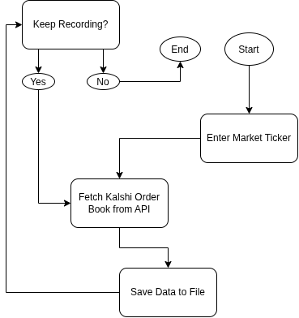

| | **Urgent** | **Not Urgent** |
|---|---|---|
| **Important** | **Do — MVP**    - Connect to Kalshi API   - Fetch and save orderbook snapshots   - Continuous recording | **Schedule — V2.0+**    - Handle API errors and interruptions   - Validate data   - Support recurring 15-minute markets   - Basic backtester |
| **Not Important** | **Delegate — Use a Library**    - Terminal output formatting | **Delete — Cut It**    - GUI   - Trading execution |

# Flowchart

